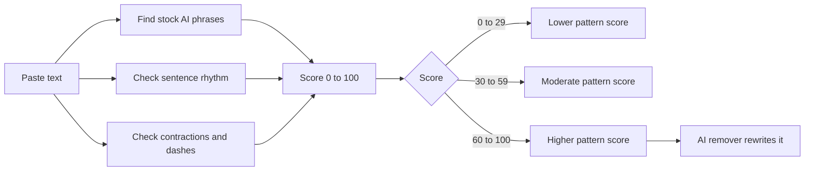

<div align="center">

# 🐙 Octo

### Writing intelligence · Document Studio · Academic research tools
**A free, open-source writing and document workspace with transparent analysis and an evolving academic research toolkit.**

[](https://dapperdude404.github.io/octo/app/)
[](https://github.com/dapperdude404/octo/releases/tag/v5.0.0)

**[▶ Open the current live demo directly](https://dapperdude404.github.io/octo/app/)** · [Classic v1 demo](https://dapperdude404.github.io/octo/)


[](https://github.com/dapperdude404/octo/stargazers)
[](https://github.com/dapperdude404/octo/fork)

[🚀 Live Demo](https://dapperdude404.github.io/octo/app/) · [Releases](https://github.com/dapperdude404/octo/releases) · [Try it](#-try-it-in-30-seconds) · [Tools](#-the-eight-arms-and-more) · [How it works](#-how-the-detector-works) · [Run it](#-run-it) · [FAQ](#-faq) · [Contribute](#-contribute)

</div>

---

## Octo AI Studio

The studio groups writing, documents, and vision tools in a responsive dashboard. The assistant can outline, summarize, proofread, draft email templates, and send suggested text to the writing editor. Local mode uses rules in the browser. Connected AI uses the Node API and an OpenAI model.

- **Documents.** Open PDF, DOCX, or TXT and export editable Word, PDF, TXT, HTML, Markdown, or JSON. PDF Maker supports A4 and US Letter, font sizes, page numbers, and a custom font. Conversions preserve extracted text. Scanned PDFs need OCR, and preserving original Word or PDF layouts requires a separate converter.
- **PDF Pages.** Merge PDFs, extract page ranges, or turn JPG and PNG images into a PDF.
- **Face recognition.** Enroll a reference photo with permission, compare one face at a time, and remove saved profiles when done. The model runs locally and stores profile names and numeric face vectors in the browser. Match results are similarity estimates.
- **Writing.** Use the original pattern, clarity, grammar, comparison, and provider tools. Choose from five accent palettes in light or dark mode.

From the repository root, run `npm --prefix ai-octopus-v2 run preview` and open the address it prints. This preview needs Node.js 22.18 or later. Browser tools need no service keys.

For the connected assistant, configure `OPENAI_API_KEY` on the API server, optionally choose `OPENAI_MODEL`, and sign in using the workspace account. The API needs the existing PostgreSQL and JWT settings. Your prompt and recent connected conversation go to the model. The current draft is included only when selected.

The canonical frontend is in `ai-octopus-v2/web`. Run `npm --prefix ai-octopus-v2 run web:sync` after editing it, then `npm --prefix ai-octopus-v2 run web:check`. The browser libraries and license files live in `app/vendor`. The Android and API builds copy those assets into their public bundle.

### Windows desktop

The **Build Octo AI Studio for Windows** workflow produces a portable 64-bit executable. Download the workflow artifact, extract the ZIP, and open `Octo-AI-Studio-Windows-x64.exe`. The artifact includes a SHA-256 checksum. Document, local assistant, and face tools are bundled with the app.

On a Windows development machine, run `npm ci` and `npm run build:win` from `desktop/`. The executable is saved under `desktop/dist/`. Run `npm run test:win` after building to check the packaged workspace and document conversion.

For connected tools, set the server address in account settings and sign in with email. The API server must allow the desktop origin `octo://studio`. Use HTTPS for a remote server. The OpenAI key stays on the server.

## 👋 About
Hi, I'm **Aryan Sengar**, an M.Tech student. I built Octo as a free tool for students and writers who want to check their text and finish everyday tasks in one place.

**Developer:** [dapperdude404](https://github.com/dapperdude404) · **Portfolio:** [Aryan Sengar — AI & Engineering](https://ai-journey-engineering-portfolio.leafyhutch64.chatgpt.site)

## ✨ Latest release: v5.0.0 — Academic Research Studio foundation

**GitHub release v5.0.0 is published.** It includes initial research-oriented code modules: partial explainable academic quality indicators, structured revision suggestions, local duplicate/reference matching, citation checks, and metrics recomputed from supplied confusion matrices. These are **development foundations**, not a complete end-to-end research studio in the live demo.

**Not yet available in the live demo:** full side-by-side research editor, official IEEE two-column DOCX/PDF generation, licensed Turnitin scanning, or verified external plagiarism database matching. Turnitin requires an officially authorized integration. Local writing signals must not be treated as verified authorship probabilities.

[📦 Download v5.0.0](https://github.com/dapperdude404/octo/releases/tag/v5.0.0) · [📋 V5 scope and checklist](ACADEMIC_RESEARCH_STUDIO_V5.md) · [🌐 Open current live demo](https://dapperdude404.github.io/octo/app/)

## 📄 Existing live features (introduced in v2.5.0)

**Document Studio** imports PDF, DOCX and TXT into editable text, then exports DOCX, TXT, HTML, Markdown and JSON. A browser print dialog supports **Save as PDF**. PDF conversion extracts selectable text and does not preserve complex layouts; scanned PDFs still need OCR.

**Visual themes:** Aurora, Plasma and Solar palettes, plus independent light/dark mode. Your selection is remembered on your device.

[Launch Document Studio](https://dapperdude404.github.io/octo/app/#workspace) · [Read original v2.5 release notes](https://github.com/dapperdude404/octo/releases/tag/v2.5.0)

## 🧪 V5 academic research feature status

| Research capability | Status | Notes |
|---|---|---|
| Explainable academic quality indicators | Source module available | Partial heuristic assessment; scientific accuracy and originality are not verified |
| Revision suggestions and accept/reject logic | Source module available | Research editor UI not yet connected |
| Local plagiarism review | Source module available | Exact duplicate and user-provided reference matching only; no external corpus |
| Citation/reference checks | Source module available | Structural warnings, not independent source verification |
| Research metric validation | Source module available | Metrics recomputed from supplied confusion matrices; not model retraining |
| GPTZero, Winston AI, Copyleaks | Credential-dependent | Provider results must be reported separately from local heuristics |
| Turnitin scan | Not available | Requires officially authorized institutional or partner integration |
| IEEE two-column DOCX/PDF generator | Planned | Official target journal/conference template and export tests required |
| Full V5 web/Android research UI | Planned | Existing live demo remains the Document Studio interface |

**Accuracy and transparency:** A local writing-pattern score is not a verified probability of AI authorship. A local text match is not a licensed plagiarism report. No experimental result is claimed without supporting data.

## 🚀 AI Octopus — Current Live Demo

**[▶ Launch AI Octopus in your browser](https://dapperdude404.github.io/octo/app/)**

The current browser demo provides the **v2.5 Document Studio-era interface**; V5 research modules have not yet been integrated into this interface. The demo button opens the application directly. Try the AI pattern detector, clarity editor, grammar checker, and draft comparison. Browser-local tools need no account; optional online features connect to the deployed [Render API](https://ai-octopus-api-l83b.onrender.com/api/health). Third-party scans require provider credentials.

| | Open |
|---|---|
| 🌐 **Current live demo** | **[Launch application →](https://dapperdude404.github.io/octo/app/)** |
| 📦 Latest release | [Download v5.0.0](https://github.com/dapperdude404/octo/releases/tag/v5.0.0) |
| 🐙 Classic Version 1 | [Open classic demo](https://dapperdude404.github.io/octo/) |

## ⚡ Try the live tools in 30 seconds
1. Open the **[classic demo](https://dapperdude404.github.io/octo/)** for the original tools, or the **[Version 2 demo](https://dapperdude404.github.io/octo/app/)** for the latest workspace.
2. On **AI detector**, click **Try a sample** then **Check text**.
3. Click **AI remover**, paste the same text and rewrite it.
4. Compare the score before and after.

> 💡 Add your own example or detail after rewriting. It reads more human than any rule.

## 🧰 The eight arms and more

| | Tool | What you get |
|---|---|---|
| 🔍 | **AI detector** | A 0 to 100 score with AI-style phrases highlighted |
| ✍️ | **AI remover** | Stiff AI wording turned into plain speech |
| 🔢 | **Word counter** | Words, reading time, readability |
| 🧹 | **Text cleaner** | Fix spaces, emoji, duplicates, change case |
| 📝 | **Summarizer** | Picks the key sentences |
| ✅ | **Tasks and notes** | To-do list saved in your browser |
| ⏱️ | **Focus timer** | 25, 5 and 50 minute blocks |
| 🔐 | **Password maker** | Strong passwords made on your device |
| 📄 | **File converter** | PDF, Word, Excel, CSV, text to editable text |
| 🎙️ | **Voice** | Talk to type, say "open timer" to switch tools |
| 🙂 | **Face detection** | Counts faces on your device |
| 📈 | **Predictor** | Draws a trend and projects what comes next |
| 💡 | **AI hints** | Short, practical suggestions |
| 🔮 | **2026 watch** | AI themes to keep an eye on |

<details>
<summary><b>📄 More about the File converter</b> (click to open)</summary>

<br>

Choose a PDF, Word (.docx), Excel, CSV, text, Markdown, JSON or HTML file. Octo pulls out the text so you can edit it, then save it as Word or plain text.

Scanned PDFs (pictures of pages) have no selectable text, so they come out empty.

</details>

<details>
<summary><b>🎙️ More about Voice</b> (click to open)</summary>

<br>

Click **Start listening** and speak. Try saying:
- "open timer"
- "open tasks"
- "open detector"

**Read aloud** speaks your text back to you.

</details>

<details>
<summary><b>🙂 More about Face detection</b> (click to open)</summary>

<br>

Starts your camera and draws boxes around faces. It only **counts** faces and does **not** identify anyone. Video never leaves your browser.

</details>

## 🧠 How the local writing-pattern detector works

Octo does not use a hidden AI model. It looks for patterns that AI writing often shows.



| Signal | Max points |
|---|---|
| Stock AI phrases ("delve", "tapestry") | 45 |
| Very even sentence lengths | 25 |
| No contractions in long text | 10 |
| Em dashes | 10 |
| Formal openers ("Moreover", "Furthermore") | 10 |

> ⚠️ **Scores are estimates, not proof.** Human writing can score high and edited AI text can score low. Never use Octo alone to accuse someone of using AI.

## 🚀 Run it

**Option 1: just open it**
```
Open index.html in your browser. No build step.
```

**Option 2: publish your own copy on GitHub Pages**
1. Fork this repository (or create one named `octo`).
2. Go to **Settings > Pages**.
3. Set Source to **Deploy from a branch**, choose `main` and `/ (root)`, then **Save**.
4. Your site will be at `https://YOUR-USERNAME.github.io/octo/`.

## 🌐 Browser support

| Feature | Works in |
|---|---|
| Detector, remover and everyday tools | Any modern browser |
| File converter (reading) | Any modern browser |
| Face detection | Chrome (needs the FaceDetector API) |
| Voice typing, AI hints, Save as Word/text | Inside claude.ai only. On GitHub Pages these buttons show a message |

## ❓ FAQ

<details>
<summary><b>Is Octo really free?</b></summary>
<br>Yes. It is free and open source under the MIT license.
</details>

<details>
<summary><b>Does it store my text or files?</b></summary>
<br>No. Everything runs in your browser. Tasks and notes are saved only on your own device.
</details>

<details>
<summary><b>Will the AI remover beat other AI detectors?</b></summary>
<br>Nobody can promise that. Read the result and add your own details and examples.
</details>

<details>
<summary><b>Does face detection recognize people?</b></summary>
<br>No. It only finds and counts faces.
</details>

📄 **Research paper:** [Read the paper](paper/paper.md) · [Word version](paper/Octo-Research-Paper.docx)

## 🗺️ Roadmap
- [x] v1.0.0: detector, remover and everyday tools
- [ ] Read text from scanned PDFs and images
- [ ] Make Save as Word work outside claude.ai
- [ ] Better detector with more signals and languages
- [ ] Light and dark theme switch

## 🤝 Contribute
Found a bug or have an idea?
1. Open an **[Issue](https://github.com/dapperdude404/octo/issues)**.
2. Or **fork**, make your change, and open a **Pull Request**.

## 📜 License
MIT. See [LICENSE](LICENSE).

<div align="center">

**If Octo helped you, give it a ⭐ on GitHub.**

Made with 🐙 by [Aryan Sengar](https://github.com/dapperdude404)

</div>
