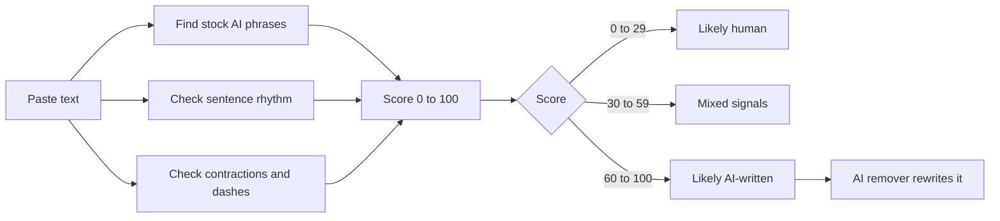

<div align="center">

# 🐙 Octo

### Eight arms. One desk.
**Check if writing sounds like AI, rewrite it in a human voice, and get the small jobs done. Free, no install.**

[](https://dapperdude404.github.io/octo/app/)
[](https://github.com/dapperdude404/octo/releases/tag/v2.5.0)

**[▶ Open the Version 2 demo directly](https://dapperdude404.github.io/octo/app/)** · [Classic v1 demo](https://dapperdude404.github.io/octo/)


[](https://github.com/dapperdude404/octo/stargazers)
[](https://github.com/dapperdude404/octo/fork)

[🚀 Version 2 Live Demo](https://dapperdude404.github.io/octo/app/) · [Releases](https://github.com/dapperdude404/octo/releases) · [Try it](#-try-it-in-30-seconds) · [Tools](#-the-eight-arms-and-more) · [How it works](#-how-the-detector-works) · [Run it](#-run-it) · [FAQ](#-faq) · [Contribute](#-contribute)

</div>

---

## 👋 About
Hi, I'm **Aryan Sengar**, an M.Tech student. I built Octo as a free tool for students and writers who want to check their text and finish everyday tasks in one place.

**Developer:** [dapperdude404](https://github.com/dapperdude404) · **Portfolio:** [Aryan Sengar — AI & Engineering](https://ai-journey-engineering-portfolio.leafyhutch64.chatgpt.site)

## ✨ What's new in v2.5.0

**Document Studio** imports PDF, DOCX and TXT into editable text, then exports DOCX, TXT, HTML, Markdown and JSON. A browser print dialog supports **Save as PDF**. PDF conversion extracts selectable text and does not preserve complex layouts; scanned PDFs still need OCR.

**Visual themes:** Aurora, Plasma and Solar palettes, plus independent light/dark mode. Your selection is remembered on your device.

[Launch Document Studio](https://dapperdude404.github.io/octo/app/#workspace) · [Read release notes](https://github.com/dapperdude404/octo/releases/tag/v2.5.0)

## 🚀 AI Octopus Version 2 — Instant Demo

**[▶ Launch AI Octopus Version 2 in your browser](https://dapperdude404.github.io/octo/app/)**

The Version 2 app is currently released as **v2.5.0**. The demo button opens the application directly. Try the AI pattern detector, clarity editor, grammar checker, and draft comparison. Browser-local tools need no account; optional online features connect to the deployed [Render API](https://ai-octopus-api-l83b.onrender.com/api/health). Third-party scans require provider credentials.

| | Open |
|---|---|
| 🌐 **Version 2 live demo** | **[Launch application →](https://dapperdude404.github.io/octo/app/)** |
| 📦 Latest release | [Download v2.5.0](https://github.com/dapperdude404/octo/releases/tag/v2.5.0) |
| 🐙 Classic Version 1 | [Open classic demo](https://dapperdude404.github.io/octo/) |

## ⚡ Try it in 30 seconds
1. Open the **[classic demo](https://dapperdude404.github.io/octo/)** for the original tools, or the **[Version 2 demo](https://dapperdude404.github.io/octo/app/)** for the latest workspace.
2. On **AI detector**, click **Try a sample** then **Check text**.
3. Click **AI remover**, paste the same text and rewrite it.
4. Compare the score before and after.

> 💡 Add your own example or detail after rewriting. It reads more human than any rule.

## 🧰 The eight arms and more

| | Tool | What you get |
|---|---|---|
| 🔍 | **AI detector** | A 0 to 100 score with AI-style phrases highlighted |
| ✍️ | **AI remover** | Stiff AI wording turned into plain speech |
| 🔢 | **Word counter** | Words, reading time, readability |
| 🧹 | **Text cleaner** | Fix spaces, emoji, duplicates, change case |
| 📝 | **Summarizer** | Picks the key sentences |
| ✅ | **Tasks and notes** | To-do list saved in your browser |
| ⏱️ | **Focus timer** | 25, 5 and 50 minute blocks |
| 🔐 | **Password maker** | Strong passwords made on your device |
| 📄 | **File converter** | PDF, Word, Excel, CSV, text to editable text |
| 🎙️ | **Voice** | Talk to type, say "open timer" to switch tools |
| 🙂 | **Face detection** | Counts faces on your device |
| 📈 | **Predictor** | Draws a trend and projects what comes next |
| 💡 | **AI hints** | Short, practical suggestions |
| 🔮 | **2026 watch** | AI themes to keep an eye on |

<details>
<summary><b>📄 More about the File converter</b> (click to open)</summary>

<br>

Choose a PDF, Word (.docx), Excel, CSV, text, Markdown, JSON or HTML file. Octo pulls out the text so you can edit it, then save it as Word or plain text.

Scanned PDFs (pictures of pages) have no selectable text, so they come out empty.

</details>

<details>
<summary><b>🎙️ More about Voice</b> (click to open)</summary>

<br>

Click **Start listening** and speak. Try saying:
- "open timer"
- "open tasks"
- "open detector"

**Read aloud** speaks your text back to you.

</details>

<details>
<summary><b>🙂 More about Face detection</b> (click to open)</summary>

<br>

Starts your camera and draws boxes around faces. It only **counts** faces and does **not** identify anyone. Video never leaves your browser.

</details>

## 🧠 How the detector works

Octo does not use a hidden AI model. It looks for patterns that AI writing often shows.



| Signal | Max points |
|---|---|
| Stock AI phrases ("delve", "tapestry") | 45 |
| Very even sentence lengths | 25 |
| No contractions in long text | 10 |
| Em dashes | 10 |
| Formal openers ("Moreover", "Furthermore") | 10 |

> ⚠️ **Scores are estimates, not proof.** Human writing can score high and edited AI text can score low. Never use Octo alone to accuse someone of using AI.

## 🚀 Run it

**Option 1: just open it**
```
Open index.html in your browser. No build step.
```

**Option 2: publish your own copy on GitHub Pages**
1. Fork this repository (or create one named `octo`).
2. Go to **Settings > Pages**.
3. Set Source to **Deploy from a branch**, choose `main` and `/ (root)`, then **Save**.
4. Your site will be at `https://YOUR-USERNAME.github.io/octo/`.

## 🌐 Browser support

| Feature | Works in |
|---|---|
| Detector, remover and everyday tools | Any modern browser |
| File converter (reading) | Any modern browser |
| Face detection | Chrome (needs the FaceDetector API) |
| Voice typing, AI hints, Save as Word/text | Inside claude.ai only. On GitHub Pages these buttons show a message |

## ❓ FAQ

<details>
<summary><b>Is Octo really free?</b></summary>
<br>Yes. It is free and open source under the MIT license.
</details>

<details>
<summary><b>Does it store my text or files?</b></summary>
<br>No. Everything runs in your browser. Tasks and notes are saved only on your own device.
</details>

<details>
<summary><b>Will the AI remover beat other AI detectors?</b></summary>
<br>Nobody can promise that. Read the result and add your own details and examples.
</details>

<details>
<summary><b>Does face detection recognize people?</b></summary>
<br>No. It only finds and counts faces.
</details>

📄 **Research paper:** [Read the paper](paper/paper.md) · [Word version](paper/Octo-Research-Paper.docx)

## 🗺️ Roadmap
- [x] v1.0.0: detector, remover and everyday tools
- [ ] Read text from scanned PDFs and images
- [ ] Make Save as Word work outside claude.ai
- [ ] Better detector with more signals and languages
- [ ] Light and dark theme switch

## 🤝 Contribute
Found a bug or have an idea?
1. Open an **[Issue](https://github.com/dapperdude404/octo/issues)**.
2. Or **fork**, make your change, and open a **Pull Request**.

## 📜 License
MIT. See [LICENSE](LICENSE).

<div align="center">

**If Octo helped you, give it a ⭐ on GitHub.**

Made with 🐙 by [Aryan Sengar](https://github.com/dapperdude404)

</div>
